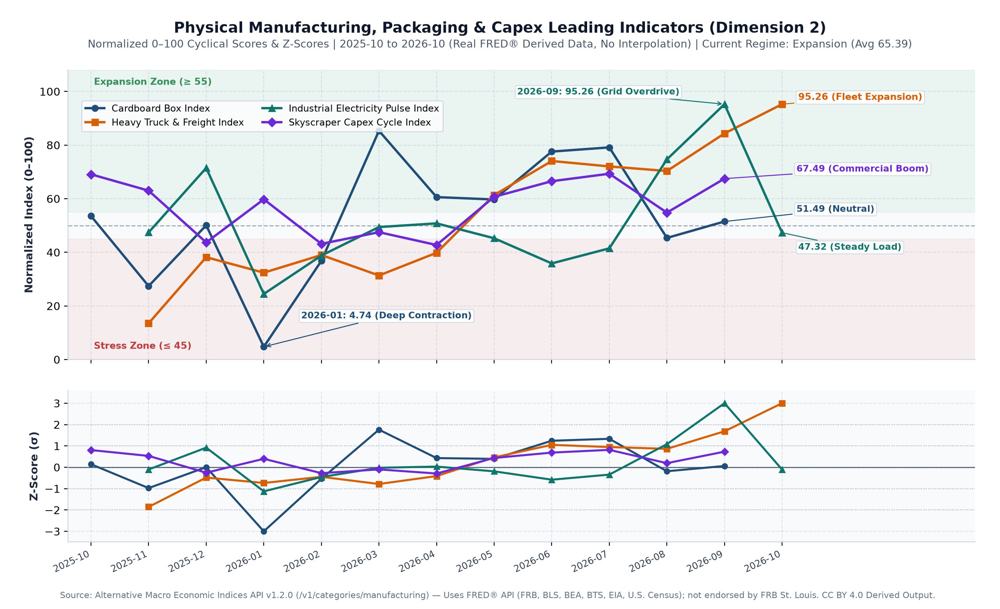
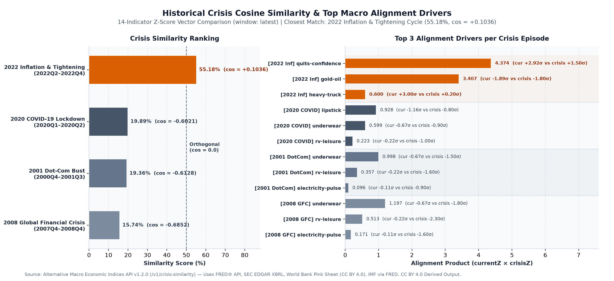

<div align="center">

<h1>Alternative Macro &amp; Economic Indices API (<code>altmacro-quant-api</code>)</h1>

<p><strong>Institutional-grade alternative macroeconomic indicators, point-in-time regime signals, and historical crisis cosine similarity for quantitative research and AI agents.</strong></p>

<p>
  <a href="https://rapidapi.com/stalter-stalter-default/api/alternative-macro-economic-indices">
    
  </a>
  &nbsp;
  <a href="https://stalter.work/index">
    
  </a>
</p>

<p>
  
  <a href="docs/openapi-1.2.0.json"></a>
  
  <a href="LICENSE"></a>
  <a href="https://rapidapi.com/stalter-stalter-default/api/alternative-macro-economic-indices"></a>
  <a href="docs/data-governance-and-licensing.md"></a>
</p>

[Overview](#overview) | [Live Previews](#live-previews) | [15 Indices](#15-alternative-indices-across-4-dimensions) | [Pricing & Tiers](#pricing-tiers--preview-mode) | [Endpoints & Time Filters](#endpoints--point-in-time-semantics) | [Quickstart](#quickstart) | [Notebooks](#interactive-notebooks) | [Governance](#data-governance--attributions) | [Project Structure](#project-structure) | [Changelog](#changelog)

</div>

*Last updated: 2026-11-25 (v1.0.0)*

---

## Overview

**Alternative Macro & Economic Indices (`altmacro-quant-api`)** transforms 15 unconventional, high-signal physical and behavioral economic series into normalized `0–100` business-cycle scores, rolling `Z-Scores`, regime classifications, Big Mac Purchasing Power Parity (PPP) cross-currency valuations, and 4-crisis historical cosine similarity vectors—delivered over RapidAPI (`https://alternative-macro-economic-indices.p.rapidapi.com`).

```text
Official Institutional Sources ──► Z-Score & 0-100 Normalization ──► RapidAPI Edge Gateway
(FRED®, SEC EDGAR, BLS, BEA,       + Spot-Quote Redaction             (7 REST Endpoints · Strict
 Census, EIA, DOT, Economist,      + Non-Fallback Point-in-Time        month/asOf Filters ·
 World Bank Pink Sheet)              Calendar Alignment                BASIC / PRO / ULTRA Tiers)
```

* **Zero Synthetic Data**: Every series is computed strictly from official institutional endpoints (`FRED®`, Federal Reserve Board H.10 FX, U.S. BLS/JOLTS, BEA, U.S. Census Bureau, EIA, DOT, SEC EDGAR XBRL, The Economist Big Mac Index, and World Bank Pink Sheet Gold)—never interpolated, carry-forwarded, or backfilled with synthetic values.
* **True Point-in-Time Backtesting (`month` vs. `asOf`)**: `month=YYYY-MM` enforces exact calendar matching (returning `null` / `[]` / `stance: "no-data"` on missing months), while `asOf=YYYY-MM` returns the newest verified observation with `dataMonth <= YYYY-MM` to prevent look-ahead bias.
* **Commercial Licensing Hygiene**: Derived quantitative metrics (`indexValue`, `zScore`, `signal`, `trend`, ratios, YoY deltas) are preserved while restricted raw third-party spot-quote fields are automatically redacted before leaving the gateway.
* **AI Agent & Quant Ready**: Ships with OpenAI-compatible function-calling schemas (`examples/ai_agent_tool.py`), a 7-endpoint CLI walkthrough (`examples/quickstart.py`), captured real payloads (`examples/responses/`), and Colab-ready Jupyter notebooks (`notebooks/`).

---

## Live Previews

All charts below are generated directly from real sanitized gateway captures under [`examples/responses/`](examples/responses/).

### Dimension 2 (`manufacturing`) Timeseries & Regime Signals
> Tracks physical packaging, freight, industrial electricity load, and commercial capex (`cardboard`, `heavy-truck`, `electricity-pulse`, `skyscraper`) via `/v1/categories/manufacturing` and `/v1/indices/cardboard`.



### Historical Crisis Cosine Similarity Radar
> Evaluates live macro regime alignment across 14 normalized Z-score dimensions against the **2001 Dot-Com**, **2008 GFC**, **2020 COVID-19**, and **2022 Inflation & Tightening** baselines via `/v1/crisis-similarity`.



---

## 15 Alternative Indices Across 4 Dimensions

| Dim | Category Slug | Index Slug | Index Name | License Class | Primary Upstream Series | Commercial Redaction |
|---:|---|---|---|---|---|---|
| 1 | `consumer` | `lipstick` | Lipstick Index | `PUBLIC_DOMAIN_US_GOV` | `SEC_EDGAR_XBRL` (EL, COTY, ULTA), `FRED:CPIAUCSL+GDPC1` | None |
| 1 | `consumer` | `underwear` | Men's Underwear Index | `PUBLIC_DOMAIN_US_GOV` | `FRED:MRTSSM4481USS`, `FRED:CUSR0000SAA1` | None |
| 1 | `consumer` | `rv-leisure` | RV & Leisure Durable Index | `PUBLIC_DOMAIN_US_GOV` | `FRED:RSMVPD\|MRTSSM441USS`, `FRED:CUSR0000SAD`, `FRED:TERMCBAUTO48NS` | None |
| 1 | `consumer` | `alcohol-scissors` | Champagne & Alcohol Scissors Index | `PUBLIC_DOMAIN_US_GOV` | `FRED:MRTSSM4453USN`, `FRED:MRTSSM722USN`, `FRED:CUSR0000SAF116` | None |
| 2 | `manufacturing` | `cardboard` | Cardboard Box Index | `PUBLIC_DOMAIN_US_GOV` | `FRED:IPN32221S`, `FRED:PCU322211322211` | None |
| 2 | `manufacturing` | `heavy-truck` | Heavy Truck & Freight Index | `PUBLIC_DOMAIN_US_GOV` | `FRED:HTRUCKSSAAR`, `FRED:TSIFRGHT`, `FRED:GASDESW` | None |
| 2 | `manufacturing` | `electricity-pulse` | Industrial Electricity Pulse Index | `PUBLIC_DOMAIN_US_GOV` | `FRED:IPG2211S`, `FRED:CAPUTLG2211S`, `FRED:IPMAN` | None |
| 2 | `manufacturing` | `skyscraper` | Skyscraper Capex Cycle Index | `PUBLIC_DOMAIN_US_GOV` | `FRED:TLCOMCONS`, `FRED:TTLCONS`, `FRED:DRCRELEXFACBS` | None |
| 3 | `commodities` | `bigmac` | Big Mac PPP Index | `CC_BY_4_0_DERIVED` | The Economist `big-mac-full-index.csv`, `FRED:H.10` (14 FX series) | None |
| 3 | `commodities` | `copper-gold` | Copper-to-Gold Ratio Index | `MIXED_OPEN_DERIVED_ONLY` | `FRED:PCOPPUSDM`, `WB:PINK_SHEET_GOLD\|FRED:IQ12260`, `FRED:DGS10` | Derived-only (raw copper & gold spot quotes redacted) |
| 3 | `commodities` | `gold-oil` | Gold-to-Oil Ratio & Stagflation Radar | `MIXED_OPEN_DERIVED_ONLY` | `FRED:DCOILWTICO`, `WB:PINK_SHEET_GOLD\|FRED:IQ12260`, `FRED:T10YIE` | Derived-only (raw gold spot quote redacted) |
| 3 | `commodities` | `breakfast-inflation` | Breakfast Table Inflation Basket | `PUBLIC_DOMAIN_US_GOV` | `FRED:APU0000708111`, `FRED:APU0000717311`, `FRED:APU0000704111` | None |
| 4 | `labor-credit` | `quits-confidence` | JOLTS Quits Confidence Index | `PUBLIC_DOMAIN_US_GOV` | `FRED:JTSQUR`, `FRED:JTSLDR`, `FRED:JTSJOR` | None |
| 4 | `labor-credit` | `vegas-credit` | Vegas Hospitality & Card Credit Stress | `PUBLIC_DOMAIN_US_GOV` | `FRED:LASV832LEIH`, `FRED:DRCCLACBS`, `FRED:REVOLSL` | None |
| 4 | `labor-credit` | `comfort-food` | Cocoa & Comfort Food Resilience Index | `MIXED_OPEN_DERIVED_ONLY` | `FRED:PCOCOUSDM`, `FRED:CUSR0000SEFR`, `FRED:IPG311S` | Derived-only (raw cocoa spot quote redacted) |

See [`docs/data-governance-and-licensing.md`](docs/data-governance-and-licensing.md) for full upstream URLs, preserved derived fields, and sanitization mechanics.

---

## Pricing Tiers & Preview Mode

Subscribe directly on **[RapidAPI Hub](https://rapidapi.com/stalter-stalter-default/api/alternative-macro-economic-indices)**:

| Feature / Quota | `BASIC` ($0/mo) | `PRO` ($14.99/mo) | `ULTRA` ($39.99/mo) |
|---|---|---|---|
| **Rate Limit** | `5 req/min` (`50 req/mo` RapidAPI quota) | `30 req/min` | `120 req/min` |
| **`/v1/health` & `/v1/catalog`** | Full access | Full access | Full access |
| **`/v1/indices/{slug}` History** | **1** latest observation (`previewMode: true` on historical filters) | Up to **36 months** (default `limit=14`) + all time filters | Up to **120 months** (default `limit=14`) + all time filters |
| **`/v1/categories/{category}`** | HTTP 200 `previewMode: true` (first 2 slugs, `limit=1`) | Full category series (all member slugs, up to 24 obs + time filters) | Full category series (all member slugs, up to 24 obs + time filters) |
| **`/v1/regime-summary`** | HTTP 200 `previewMode: true` (top-level regime & breadth summary) | Full 4-dimension synthesis (`dimension`/`category` & `month`/`asOf`) | Full 4-dimension synthesis (`dimension`/`category` & `month`/`asOf`) |
| **`/v1/crisis-similarity`** | HTTP 200 `previewMode: true` (closest crisis label only, `comparisons: []`) | HTTP 200 `previewMode: true` (closest crisis label only, `comparisons: []`) | Full 4-crisis cosine similarity matrix, `similarityPct`, `topDrivers` & `month`/`asOf` backtest |
| **`/v1/batch`** | HTTP 200 `previewMode: true` (max 2 indices, `limit=1`) | HTTP 200 `previewMode: true` (max 2 indices, `limit=1`) | Full batch matrix (up to 15 indices, `slugs`/`dimension`/`category`, up to 24 obs + time filters) |

> **Graceful `HTTP 200` Preview Mode**: Restricted queries on `BASIC` or `PRO` return **`HTTP 200`** with `"previewMode": true`, `"upgradeRequired": "PRO" | "ULTRA"`, and `"upgradeNotice"` rather than breaking client integrations with HTTP `403`. You can validate schemas and agent workflows on the free `BASIC` plan before upgrading.

---

## Endpoints & Point-in-Time Semantics

Full OpenAPI 3.0.3 machine-readable contract: [`docs/openapi-1.2.0.json`](docs/openapi-1.2.0.json)  
Base URL: `https://alternative-macro-economic-indices.p.rapidapi.com`

| Method & Path | Summary | Key Query Parameters | Full Tier |
|---|---|---|---|
| `GET /v1/health` | Gateway readiness, L1 cache coverage & active tier | — | All (`BASIC+`) |
| `GET /v1/catalog` | 15-index registry, dimensions, upstream sources & licensing | `dimension`, `category` | All (`BASIC+`) |
| `GET /v1/categories/{category}` | All member series in `consumer`, `manufacturing`, `commodities`, or `labor-credit` | `limit`, `month`, `asOf`, `fromMonth`, `toMonth` | `PRO+` |
| `GET /v1/indices/{slug}` | Single index metadata, latest reading & historical array | `limit`, `month`, `asOf`, `fromMonth`, `toMonth` | `BASIC` (1 obs) / `PRO` (36m) / `ULTRA` (120m) |
| `GET /v1/regime-summary` | Cross-dimensional macro regime, breadth & Big Mac PPP synthesis | `dimension`, `category`, `month`, `asOf` | `PRO+` |
| `GET /v1/crisis-similarity` | 4-crisis historical cosine similarity & top Z-score drivers | `window`, `month`, `asOf` | `ULTRA` |
| `GET /v1/batch` | Multi-index filtered matrix export across up to 15 slugs | `slugs`, `dimension`, `category`, `limit`, `month`, `asOf`, `fromMonth`, `toMonth` | `ULTRA` |

### Point-in-Time Query Filters (`YYYY-MM`, mutually exclusive modes)

* **`month=YYYY-MM` (Strict Exact Match)**: Returns only observations published in that exact calendar month. If an index has no publication for that month, the API returns `null` / `[]` / `stance: "no-data"` (never silent carry-forward).
* **`asOf=YYYY-MM` (Point-in-Time Snapshot)**: Selects the newest verified observation with `dataMonth <= YYYY-MM` (or empty if none exist), preventing look-ahead bias in historical simulations.
* **`fromMonth=YYYY-MM` & `toMonth=YYYY-MM` (Inclusive Range)**: Returns observations within `fromMonth <= dataMonth <= toMonth`. Supported on `/v1/categories/{category}`, `/v1/indices/{slug}`, and `/v1/batch` (rejected with HTTP `400` on snapshot-only endpoints `/v1/regime-summary` and `/v1/crisis-similarity`).

---

## Quickstart

### 1. cURL

```bash
curl --request GET \
  --url "https://alternative-macro-economic-indices.p.rapidapi.com/v1/indices/cardboard?fromMonth=2025-01&toMonth=2026-11&limit=24" \
  --header "X-RapidAPI-Key: $RAPIDAPI_KEY" \
  --header "X-RapidAPI-Host: alternative-macro-economic-indices.p.rapidapi.com"
```

### 2. Python SDK / CLI Examples (with Automatic Offline Demo Fallback)

Clone the repository and install dependencies:

```bash
git clone https://github.com/nkcDuck/altmacro-quant-api.git
cd altmacro-quant-api
pip install -r requirements.txt
```

Run the 7-endpoint CLI walkthrough and OpenAI-compatible AI agent tool wrapper directly—**even without a `RAPIDAPI_KEY`**, both scripts automatically fall back to the sanitized real gateway captures in `examples/responses/`:

```bash
# Offline demo (uses examples/responses/*.json when RAPIDAPI_KEY is unset)
python examples/quickstart.py
python examples/ai_agent_tool.py

# Live RapidAPI execution (copy .env.example or export RAPIDAPI_KEY)
export RAPIDAPI_KEY="your_rapidapi_key_here"
python examples/quickstart.py
python examples/ai_agent_tool.py
```

Minimal inline Python snippet:

```python
import os
import requests

HOST = "alternative-macro-economic-indices.p.rapidapi.com"
headers = {
    "X-RapidAPI-Key": os.environ["RAPIDAPI_KEY"],
    "X-RapidAPI-Host": HOST,
}

resp = requests.get(
    f"https://{HOST}/v1/regime-summary",
    params={"category": "manufacturing", "asOf": "2026-10"},
    headers=headers,
    timeout=20,
)
resp.raise_for_status()
payload = resp.json()

if payload.get("previewMode"):
    print("Preview mode:", payload.get("upgradeNotice"))
else:
    print("Regime:", payload["data"]["overallRegime"], "| Avg Index:", payload["data"]["avgProCyclicalIndex"])
```

---

## Interactive Notebooks

Both notebooks ship pre-executed with verified cell outputs, support `DEMO_MODE=True` offline fallback out of the box, and work directly in Google Colab:

| Notebook | Coverage & Tier Compatibility | Launch |
|---|---|---|
| [`01_quickstart_and_category_explorer.ipynb`](notebooks/01_quickstart_and_category_explorer.ipynb) | All 7 endpoints, `BASIC` `previewMode` handling, `PRO` category series & strict `month` vs. `asOf` time-filter analysis | [](https://colab.research.google.com/github/nkcDuck/altmacro-quant-api/blob/main/notebooks/01_quickstart_and_category_explorer.ipynb) |
| [`02_crisis_similarity_and_macro_backtest.ipynb`](notebooks/02_crisis_similarity_and_macro_backtest.ipynb) | `ULTRA` 4-crisis cosine similarity radar, Z-score driver decomposition & point-in-time macro regime backtest | [](https://colab.research.google.com/github/nkcDuck/altmacro-quant-api/blob/main/notebooks/02_crisis_similarity_and_macro_backtest.ipynb) |

---

## Data Governance & Attributions

Full upstream series mapping, compliance registry rules, and sanitization details live in [`docs/data-governance-and-licensing.md`](docs/data-governance-and-licensing.md).

### Mandatory Upstream Notices

* **FRED® API**: *This product uses the FRED® API but is not endorsed or certified by the Federal Reserve Bank of St. Louis.* (Incorporates series from the Board of Governors of the Federal Reserve System H.10 FX & Industrial Production, U.S. BLS/JOLTS, U.S. BEA, U.S. Census Bureau, U.S. EIA, and U.S. DOT.)
* **The Economist Big Mac Index**: *Contains local price data adapted from The Economist Big Mac Index dataset (CC BY 4.0).*
* **World Bank Pink Sheet**: *Contains commodity benchmark data adapted from World Bank Commodity Price Data (The Pink Sheet, CC BY 4.0).*
* **IMF Non-Endorsement**: *Derived indices incorporate IMF Primary Commodity Price System series retrieved via FRED; IMF does not endorse this product.*
* **SEC EDGAR XBRL**: *Corporate revenue fundamentals are parsed from public U.S. SEC EDGAR XBRL filings.*
* **Research Disclaimer**: *For macroeconomic, statistical, and quantitative research purposes only. Does not constitute investment advice, securities recommendations, or regulated advisory services.*

### Explore Live & Subscribe

* **RapidAPI Marketplace**: [`alternative-macro-economic-indices`](https://rapidapi.com/stalter-stalter-default/api/alternative-macro-economic-indices)
* **Interactive Web Terminal**: [`https://stalter.work/index`](https://stalter.work/index)

---

## Project Structure

```text
altmacro-quant-api/
├── .env.example                                 # RapidAPI key environment template
├── .gitignore                                   # Secret, bytecode, venv, and checkpoint ignores
├── LICENSE                                      # Dual notice: MIT (code/notebooks) + CC BY 4.0 (API output)
├── README.md                                    # Product overview, endpoint docs, and quickstart guide
├── requirements.txt                             # Lightweight Python dependencies for CLIs and notebooks
├── assets/
│   ├── crisis_similarity_preview.png            # 4-crisis cosine similarity radar generated from real captures
│   └── manufacturing_timeseries_preview.png     # Dimension 2 manufacturing & cardboard timeseries preview chart
├── docs/
│   ├── data-governance-and-licensing.md         # Zero Synthetic Data policy, 15-index provenance & redaction table
│   └── openapi-1.2.0.json                       # Public OpenAPI 3.0.3 spec targeting RapidAPI gateway
├── examples/
│   ├── ai_agent_tool.py                         # OpenAI function-calling schemas & offline-capable dispatcher
│   ├── quickstart.py                            # 7-endpoint CLI walkthrough with previewMode & offline fallback
│   └── responses/
│       ├── batch-commodities.json               # Real sanitized /v1/batch?category=commodities&limit=6 capture
│       ├── catalog-manufacturing.json           # Real sanitized /v1/catalog?category=manufacturing capture
│       ├── category-manufacturing.json          # Real sanitized /v1/categories/manufacturing?limit=12 capture
│       ├── crisis-similarity.json               # Real sanitized /v1/crisis-similarity?window=latest capture
│       ├── health.json                          # Real sanitized /v1/health capture
│       ├── index-cardboard-range.json           # Real sanitized /v1/indices/cardboard range capture
│       └── regime-summary-manufacturing.json    # Real sanitized /v1/regime-summary?category=manufacturing capture
└── notebooks/
    ├── 01_quickstart_and_category_explorer.ipynb # Executed quickstart, previewMode & time-filter explorer
    └── 02_crisis_similarity_and_macro_backtest.ipynb # Executed 4-crisis cosine radar & macro regime backtest
```

---

## Changelog

### v1.0.0 (2026-11-25)
* **Initial Public Release**: Published OpenAPI 1.2.0 specification (`docs/openapi-1.2.0.json`), complete 15-index data governance matrix (`docs/data-governance-and-licensing.md`), 7 verbatim sanitized gateway captures (`examples/responses/`), 2 real-data preview charts (`assets/`), Python quickstart & AI agent tool wrappers (`examples/`), and 2 end-to-end executed Colab notebooks (`notebooks/`).

---

## License

Dual-licensed under [`LICENSE`](LICENSE):
* **Repository Code, Python Examples & Notebooks**: [MIT License](LICENSE) (`Copyright (c) 2026 nkcDuck / AltMacro Quant Data`).
* **API Quantitative Outputs & Captured Samples**: [CC BY 4.0](https://creativecommons.org/licenses/by/4.0/) subject to RapidAPI Terms of Service and mandatory upstream attributions.

*Last updated: 2026-11-25 (v1.0.0)*
